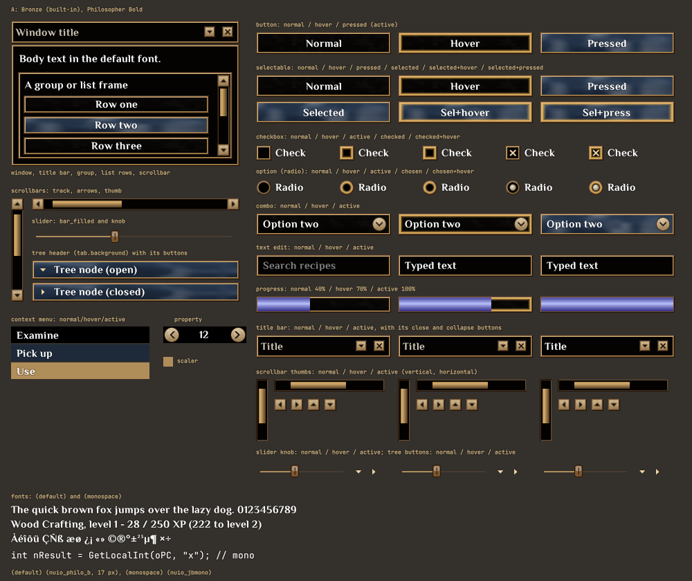
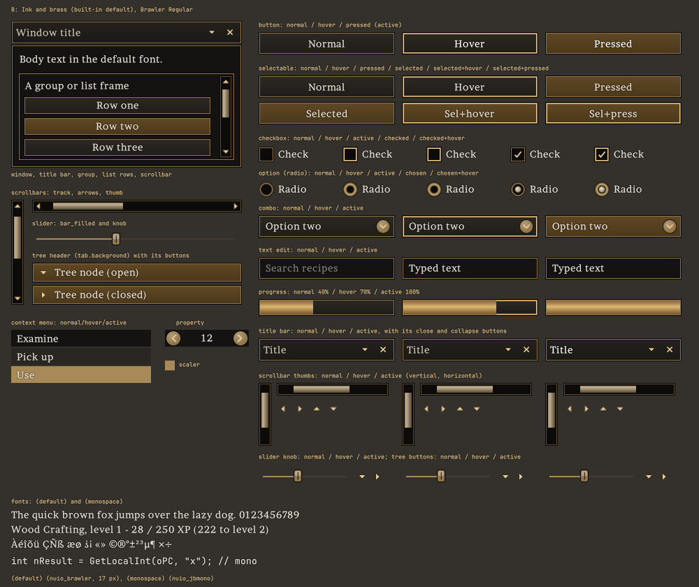
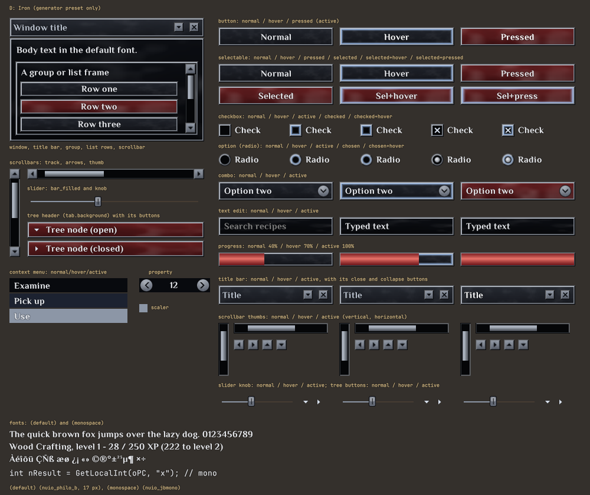

# The built-in skins

When no game folder is loaded, the designer needs a skin of its own, and a public repository can't ship Beamdog's
NUI textures, `nui_skin.tml` or `fnt_maintext`. This document says what ships, and the research it was chosen from
(game build NWN:EE 8193.37-17). How the skins are rebuilt and packed: [the tools' README](../tools/open-skin/README.md)
and the README's [command line](../README.md#command-line). Their open gaps: [GAPS.md](GAPS.md#skin-editor).

- [What ships](#what-ships)
- [What a skin consists of](#what-a-skin-consists-of)
- [Fonts](#fonts)
- [Ways to make the art](#ways-to-make-the-art)
- [The candidates](#the-candidates)
- [Provenance rules followed](#provenance-rules-followed)

## What ships

| Question | Decision |
|---|---|
| Look | **Five themes**, to give an idea or a starting point. The default is **B "Ink and brass"**; **A "Bronze"** is close to the stock look; the steampunk three are **S1 "Brass and soot"** (`s-brass`), **S2 "Verdigris and paper"** (`s-verdigris`, the one light skin) and **S3 "Oxblood and rivets"** (`s-oxblood`). D "Iron" is a generator preset only (`pnpm skin preset d-iron`). |
| Text font | **Brawler Regular** for Ink and brass, **Philosopher Bold** for Bronze, **Old Standard TT Bold** for Brass and soot, **Spectral SemiBold** (at 19) for Verdigris and paper, **Zilla Slab SemiBold** (at 18) for Oxblood and rivets. The steampunk three add a `display` font for headings: **Rye**, **Federant**, **Cinzel Decorative Bold**. `(monospace)` is JetBrains Mono 2.304 in all five, byte for byte the game's. All unmodified, SIL OFL 1.1. |
| Licence | **CC0 1.0** for the generated skins (textures, `nui_skin.tml`). The code is MIT. The fonts keep their OFL. |
| Modified fonts | **None.** |
| Texture names | **The game's names** (`nui_windowh`, `nui_button_n`, …), so a hak that replaces one still shows over the built-in skin as it would over the game's; plus the skins' own `nuio_*` extras (`nuio_trackh`, and `nuio_title` for Ink and brass's title bar). |

- **`assets/skin/ink/`**, **`bronze/`**, **`brass/`**, **`verdigris/`** and **`oxblood/`** are each a complete skin:
  `nui_skin.tml` (every key the client reads; `pnpm skin check`: 0 errors, 0 warnings); the textures (32-bit TGA,
  about 0.5 MB: 32 for Bronze, 33 for the others); the text font, `nuio_jbmono.ttf` and (steampunk) the display font,
  each with its `OFL-*.txt`; `LICENSE`; `PROVENANCE.md`. They are generated: `pnpm skin ship` writes them from the
  presets `b-clean`, `a-bronze`, `s-brass`, `s-verdigris` and `s-oxblood`, and `--check` (also a unit test) confirms
  the committed files are exactly what the generator makes. `src/core/skin/themes.ts` lists them and `fallback.ts`
  loads them.
- **As haks**, built on demand (`pnpm skin hak --theme ID`, reproducible with `SOURCE_DATE_EPOCH`; the test pins each
  one's sha256): `nuid_ink_skin.hak` (default), `nuid_bronze_skin.hak`, `nuid_brass_skin.hak`, `nuid_verdi_skin.hak`
  and `nuid_oxbld_skin.hak`, 39 to 42 resources, 0.6 to 1 MB, with the licence texts as `.txt` resources
  (`nuio_skin_lic`, `ofl_`, `nuio_skin_prov`; font resrefs are at most 12 characters so `ofl_` fits in
  16). (Before Ink and brass became the default, the single hak was `nuid_open_skin.hak`, Bronze; a module listing
  that name needs the new one.)
- **Why five**: the steampunk shortlist was meant to pick one third skin; all three shipped instead, as starting
  points in different directions, since nobody knows which way someone will take their game's look. Verdigris
  and paper's text font went from 22 to 19 so three-line text laid out for a 17 px line does not clip (Layonara's
  furniture window). A light skin shows windows that hard-code a light text colour (that window's gold title line)
  at low contrast; that is the window's choice, not the skin's.
- **Why B and A.** A is the closest to what the game shows, which is the point of a preview; B reads cleanest. Both
  are fully ours (procedural, no attribution, no third-party art), and their look is a `Style` of about 30 numbers the
  skin editor's Generator panel exposes. A was chosen first, alone; B became the default the same day, with Brawler,
  once the client's text model was known (below). C was dropped for its CC-BY licence and busy wood under text; NUID
  Glyphic for old-style digits that misread, a modified font, and widths that depended on the text model.

### Brawler and Philosopher with the client's text model

On a local corpus (242 strings, 8,927 characters of three real windows, four box widths):

| Font | Width vs `fnt_maintext` | Lines identical | Δ lines | Under the em model (not the client's) |
|---|---|---|---|---|
| Brawler Regular (B) | 1.000 | 88 % of 504 | −3 | 1.125, 46 % |
| Philosopher Bold (A) | 1.002 | 90 % of 505 | −1 | 1.056, 70 % |

Drawn with each theme without a game, three large windows clip nothing; over 32 real windows both themes clip the
same 5 elements (one label 1 px wider with Brawler). Nothing was tuned.

## What a skin consists of

Sources: [CLIENT-BEHAVIOUR.md](CLIENT-BEHAVIOUR.md#skin-keys) (every key, its type and its fixed 9-slice margins), the
game's files (`nui_skin.tml` in `data/ovr.bif`, the textures in `data/bd_nui.bif`), and nuklear.h for the font baker.
The checker run on the stock 37-17 file reports 0 errors and 0 warnings, and as notes only Beamdog's own quirks: the
chart colours under `[chart]`, where the client never reads them, and `scrollh.border_color` and `property.hover`.

Because the client fixes the margins, **any frame detail must fit within 3 px of the edge** (7 px on hover art), or it
stretches with the widget.

### The stock textures

All uncompressed TGA (type 2), 32-bit with alpha and bottom-left origin, except the three `_d` ones (24-bit). 32
files; the stock skin names 27. The descriptions are of the look only; nothing was copied into any candidate.

| Texture | Size | Used by (stock skin) | Drawn as | Look |
|---|---|---|---|---|
| `nui_windowh` | 512×350 | `window.border_image`, `border.border_image`, `window.header.*`, `scrollh.normal/hover/active`, `edit.*` | 9-slice 3 | Black field inside a 3 px bronze rim: dark brown outer line, mid brown, bright tan-gold inner line. |
| `nui_windowv` | 353×411 | `scrollv.normal/hover/active` | 9-slice 3 | As `nui_windowh` (inner line a little brighter). |
| `nui_header` | 341×42 | `tab.background` | 9-slice 5,3,3,3 | The bronze rim around a cloudy steel-blue field. |
| `nui_button_n` | 228×42 | `button.normal`, `selectable.normal`, `progress.normal`, `combo.normal` | 9-slice 3 | Bronze rim, black field. |
| `nui_button_h` | 228×42 | `button.hover`, `selectable.hover`, `progress.hover/active`, `combo.hover` | 9-slice 7 | Bronze rim and a bright yellow-gold inner line fading inward over about 4 px. |
| `nui_button_a` | 228×42 | `button.active`, `selectable.pressed/normal_active`, `combo.active` | 9-slice 3 | Bronze rim, cloudy dark steel-blue field. |
| `nui_button_ah` | 228×42 | `selectable.pressed_active/hover_active` | 9-slice 3 | The blue field with the hover gold line. |
| `nui_button_d` | 228×42 (24-bit) | not named | | Grey rim on black. |
| `nui_checkbox_n` / `_h` / `_d` | 23×22 | `checkbox.normal`; `hover/active`; not named | stretched | Bronze square frame; with a gold inner line; grey. |
| `nui_checkbox_x` | 15×14 | `checkbox.cursor_*` | stretched | An X in shaded bronze on black. |
| `nui_radial_n` / `_h` / `_d` | 27×27 | `option.normal`; `hover/active`; not named | stretched | Bronze ring, transparent corners; brighter gold; grey. |
| `nui_radial_x` | 16×16 | `option.cursor_*` | stretched | A gold broken ring around a dark centre. |
| `nui_close` | 14×14 | `window.header.close_button.*` | stretched | A dark X on a parchment-gold bevelled tile. |
| `nui_cnt_up/down/left/right` | 14×14 | scrollbar `dec_button`/`inc_button`; `nui_cnt_down` also `window.header.minimize_button.*` | stretched | A dark outlined triangle on a parchment tile. |
| `nui_minimize`, `nui_maximize` | 16×16 | `tab.*_button.*` | stretched | A small gold triangle on transparent. |
| `nui_scrollv`, `nui_scrollh` | 16×16 | `scrollv/scrollh.cursor_*` | thumb strip | Gold ridges on black between gold side bands. |
| `nui_slider` | 12×16 | `slider.cursor_*` | stretched | A tan lozenge knob. |
| `nui_progress` | 8×18 | `progress.cursor_*` | stretched | White centre line, blue-violet fading to navy. |
| `nui_shld_down/left/right` | 28×28 | `combo.button.*`, `property.dec/inc_button.*` | stretched | Shield-shaped parchment-gold arrow buttons. |
| `nui_shld_up` | 28×28 | not named | | As above, pointing up. |
| `nui_test` | 421×350 | not named | | A black field in a bronze rim. |

Stock colours: text white; title labels `#C8C8C8` (active white); scaler, chart, scrollbar and edit borders
`#AD8E60`; window background black; context-menu entries black, active `#AD8E60`; scrollbar size 18; selectable,
combo content and edit `padding_x` 10; scrollbar padding 4, 2; title button padding 5, 5.

### The stock fonts

| Skin name | Resref | Size | What it is | Licence |
|---|---|---|---|---|
| `(default)` | `fnt_maintext` | 17, `pixel_snap`, oversample 1/1, `spacing_h` 0.5 | "Neverwinter Nights EE Main Text" v1.034, Bold: based on Mordred (Typographer Mediengestaltung, 2000), with glyphs from Times New Roman. A flared, calligraphic sans with a small x-height and wide word spacing. Every printable Latin-1 character except U+00A0 and U+00AD. | **Not open**: all rights reserved. Can't ship. |
| `(monospace)` | `jbmonoreg` | 17, as above | JetBrains Mono Regular 2.304, byte for byte upstream (sha256 `a0bf60ef…d138f`). | OFL 1.1, no Reserved Font Name: shipped from upstream. |

The game also ships `fnt_default` (Merriweather Sans based, OFL), `fnt_default_hr` (Brawler and Bitter based, OFL)
and 15 more JetBrains Mono styles; the stock skin doesn't list them.

## Fonts

The client sizes fonts by Nuklear's rule (`font_size` is the hhea ascent − descent height, advances plus `spacing_h`
rounded to whole pixels; [CLIENT-BEHAVIOUR.md](CLIENT-BEHAVIOUR.md#fonts)). For `fnt_maintext` that gives almost the
same widths as an em-based model (its hhea height is 1.08 em), but for other fonts the two differ by up to about 30 %
(JetBrains Mono: a 12.9 px em at `font_size` 17). The table gives both ("nk", "em").

Thirty OFL faces from google/fonts were measured (`tools/open-skin/font_metrics.py`) and looked at in a specimen
(`specimen.py`). Widths are measured on 249 real UI strings (9,033 characters, a local corpus not committed). **Wrap
agreement** is the share of 111 strings × 4 box widths (160, 250, 350, 450 px) that break into the same lines as
`fnt_maintext`; Δ lines is the total change in line count.

| Font | Licence, RFN | Weight | em px (nk) | Width vs stock (nk) | Width vs stock (em) | x-height px | Cap px | Asc / desc px | Latin-1 | Wrap agreement | Δ lines |
|---|---|---|---|---|---|---|---|---|---|---|---|
| *`fnt_maintext` (reference)* | *not open* | *700* | *15.74* | *1.000* | *1.000* | *5.8* | *9.7* | *10.8 / 4.1* | *all* | *100%* | *0* |
| **Philosopher Bold** | OFL, none | 700 | 15.18 | 0.984 | 1.039 | 7.1 | 10.0 | 10.0 / 2.9 | all | **90%** | **0** |
| Philosopher Regular | OFL, none | 400 | 15.18 | 0.963 | 1.002 | 7.1 | 10.0 | 10.0 / 2.9 | all | 84% | −20 |
| **Brawler Regular** | OFL, none | 400 | 13.95 | 0.983 | 1.106 | 7.3 | 9.8 | 10.5 / 3.1 | all | 86% | −3 |
| NUID Glyphic (Marcellus, word space widened) | OFL, RFN "Marcellus": renamed | 400 | 13.56 | 1.004 | 1.171 | 6.8 | 9.5 | 9.9 / 3.4 | all | **93%** | +5 |
| Marcellus (unmodified) | OFL, RFN "Marcellus" | 400 | 13.56 | 0.930 | 1.064 | 6.8 | 9.5 | 9.9 / 3.4 | all | 60% | −55 |
| MedievalSharp | OFL, RFN "MedievalSharp" | 500 | 15.05 | 1.011 | 1.082 | 8.3 | 11.1 | 11.1 / 2.8 | all | 82% | +16 |
| Tenor Sans | OFL, RFN "Tenor", "Tenor Sans" | 400 | 14.53 | 1.046 | 1.149 | 7.3 | 10.2 | 10.2 / 3.6 | **missing ² ³ ¹ ¼ ½ ¾** | 65% | +46 |
| Merriweather Sans 400 (an early fallback) | OFL, RFN "Merriweather" | 400 | 13.52 | 0.945 | 1.098 | 7.5 | 10.1 | 11.0 / 3.3 | all | 76% | −30 |
| JetBrains Mono (`(monospace)`) | OFL, none | 400 | 12.88 | n/a | | 7.1 | 9.4 | 9.4 / 2.3 | all | | |

Every font was pinned to google/fonts commit `7af0d90b` (JetBrains Mono to its v2.304 tag) with a sha256; the
shipped ones still are, in `tools/open-skin/sources.toml`.

The stock font has wide word spaces (8 px at 17 px; the candidates 3 to 6 px) and a small x-height, so an unmodified
face wraps differently even when its total width matches. NUID Glyphic showed the fix (widen only the space glyph, an
OFL Modified Version renamed because of the Reserved Font Name): wrap agreement rose from 60 % to 93 %.

- **Philosopher** is the closest in feel: flared, calligraphic, humanist, like Mordred. It is the only face within 4 %
  of stock under both text models (its hhea height, 1.12 em, is close to stock's).
- **Brawler** is a sturdy slab-ish serif: readable, quiet, less "fantasy". Beamdog's own hi-res default font is built on
  it.
- **NUID Glyphic** (Marcellus) is a glyphic, Trajan-like serif with the closest rhythm, but its **old-style digits read
  "1" as "I" and "0" as "O"**: bad for a UI full of numbers.
- **MedievalSharp** is the most "fantasy" and readable at 17 px, but wider.
- **Tenor Sans** is elegant and wide, wraps worst, and lacks six Latin-1 characters (drawn as `?`).

## Ways to make the art

**(a) Procedural** (what ships): every texture drawn from about 30 numbers (`Style`): vertical gradients, seeded value
noise for mottled fills (stretched into streaks for brushed metal, with optional per-pixel grain for paper and leather),
1 px rims with an optional bevel, a thin lit pipe over the rims and studs in the corners (both held within the 3 px
margin), inner glows within the 7 px hover margin, anti-aliased marks. A style can add a second face as a `display`
font for headings, which windows pick with `NuiStyleFont` (the client has no per-widget font in the skin).
The licence is entirely ours, a new look takes minutes, and the client's margins are respected by construction. Limits:
no hand-painted detail (the stock shield arrows, the ridged grips), and noise fills look slightly "digital" next to
stock's painted clouds.

**(b) A CC0 or CC-BY kit**:

| Kit | Licence | Fit |
|---|---|---|
| Kenney "UI Pack: RPG Expansion" | CC0 | Poor: bright cartoon panels. |
| Kenney "Fantasy UI Borders" (2023) | CC0 | Poor: corner ornaments of 8–16 px stretch under 3 px margins. |
| "Free Fantasy Game GUI" (gameart2d, OpenGameArt) | CC0 | Poor: glossy mobile-game cartoon. |
| "Golden UI" by Buch (OpenGameArt, 2013) | CC0 (the "Bigger Than Ever" edition CC-BY-SA 3.0) | Poor: pixel art at another scale. |
| **"RPG GUI construction kit v1.0" by Lamoot (OpenGameArt node 4004)** | **CC-BY 3.0, credit required** | **Good**: gold rims about 3 px on dark wood, shield arrows, toggles. Candidate C was built from it. |
| "Arkana-FTS GUI" (OpenGameArt) | GPL-2/3, CC-BY-SA 3.0 | Not examined: share-alike for art users ship. |

CC-BY would have meant credit in every module that ships the skin, and one more licence beside MIT and CC0.

**(c) Hand-drawn**: 3–5 days of a pixel artist's time (frames and states, 17 small icons, checking in the client),
roughly a few hundred to 1,500 USD commissioned (a guess), a written licence grant, and nothing rebuildable. A middle
way: procedural frames with a handful of hand-drawn icons (arrows, grips), where painting shows most and costs least.

## The candidates

| | A: Bronze | B: Ink and brass | C: Gold and wood (kit) | D: Iron |
|---|---|---|---|---|
| How close to stock | closest | stock layout, flat | different material, same spirit | a different look |
| Look | Black panels, a three-line bronze rim with a slight bevel, a warm gold glow on hover, mottled steel blue for pressed and selected, parchment-gold title and scroll buttons. | Dark grey panels, one thin brass line, a single bright line on hover, flat amber for pressed and selected, a check mark for ticks, no noise. | Gold rims on dark wood, the kit's shield arrows, amber-tinted wood for selected. | Cold iron rims with a raised bevel on blue-black panels, crimson for pressed and selected, a pale blue hover glow. |
| Made by | procedural, `a-bronze` | procedural, `b-clean` | Lamoot's kit, adapted | procedural, `d-iron` |
| Default font | Philosopher Bold | Brawler | NUID Glyphic | MedievalSharp |
| Status | shipped, second theme | shipped, default | removed | preset only |

All keep the stock layout exactly (the skin has no say in layout). Widget sheets (drawn by `pnpm skin sheet`):

Renders of real windows with the stock skin and each candidate stay out of git (they show Beamdog's and a server's
art).

Questions about the skins in the client:

- **Is the centre of `window.border_image` drawn over the body?** Harmless for both themes: its centre is the same
  colour as `window.fixed_background`.
- **The `_d` (disabled) textures** are not named by the skin; whether the client loads them by name elsewhere is
  unknown. The skins provide them anyway.
- **Header height**: the title bar's 33 px does not come from the skin (there is no key for it), so a different header
  texture probably doesn't change it; untested.
- **UI scale**: the art was reviewed at 1.0 only. At 2.0 the client scales textures up; the 14–16 px icons will blur,
  as stock's do.
- nui-preview can't draw a textured `window.fixed_background` (it reads it as a colour); the skins don't use one.

## Provenance rules followed

- No Beamdog file is in git: no texture, font, `nui_skin.tml` or render made with them. The game's files were read
  locally to inventory them, measure `fnt_maintext` and render comparisons.
- No pixel comes from a Beamdog texture. The procedural art comes from numbers whose palettes were picked by hand for
  each look, not sampled. The stock look is described in words above; similar looks were made independently.
- No number from `fnt_maintext` is in any shipped file. (NUID Glyphic, research only and removed, took one measured
  number from it, the 8 px word space at 17 px.)
- Every third-party input is pinned with its sha256 and licence in `tools/open-skin/sources.toml`, and every skin
  carries a `PROVENANCE.md`.
